# OpenDLP

OpenDLP 是一个数据防泄漏（DLP）管理平台，由三部分组成：

- **管理控制台**：Go 后端 + 原生 JavaScript 前端，数据存储在 PostgreSQL；
- **终端 Agent**（`opendlp-agent`）：跨平台用户态程序，检测拷贝到 U 盘和同步目录中的敏感文件；
- **上报接口**：网关、邮件 MTA、审批门户等第三方系统通过共享令牌上报检测结果与审批申请。

这是一个早期版本，能力边界见下文「功能与限制」。在评估或部署前请先阅读这一节。

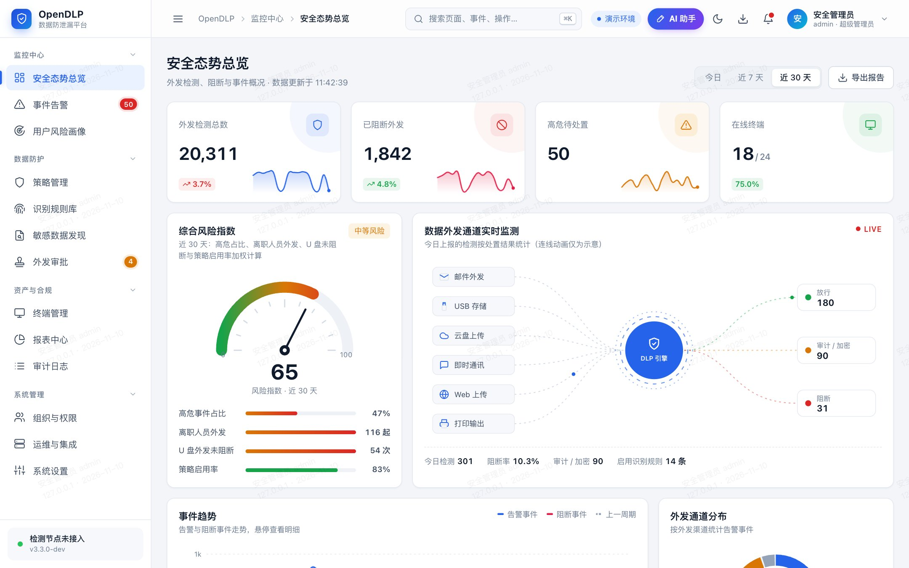

> 本文所有截图来自演示模式（`-demo`）：人员、终端、事件、审批等数据均由程序随机生成，用于展示界面，不代表真实检测效果。

## 功能与限制

| 模块 | 已实现 | 未实现 / 限制 |
| --- | --- | --- |
| 内容识别 | RE2 正则（身份证 GB 11643 校验位、银行卡 Luhn 校验）、关键词（区分大小写的子串匹配）、文件扩展名；提取纯文本、docx / xlsx / pptx、一层 zip | 无 EDM 精确数据比对、文档指纹、机器学习分类、OCR；PDF 等其他二进制格式只取可打印的 UTF-8 片段 |
| 终端 Agent | 注册换取独立凭据；心跳、按 ETag 同步策略并本地缓存；轮询 U 盘（macOS / Linux / Windows）与配置目录；阻断策略将文件移入本地隔离区并留下说明文件；离线队列补报；推送策略、远程扫描指令 | 写入后检测，不能在写入前拦截；不管控浏览器上传、邮件客户端、打印、剪贴板；不支持网络隔离、自动升级、加密放行 |
| 事件与处置 | 服务端分页筛选、处置 / 误报、批量处置、CSV 导出、SSE 实时推送 | — |
| 用户风险画像 | 根据近 30 天事件按规则计算风险评分，与部门平均对比；观察名单（其事件不论级别都实时告警）；严格管控（该用户终端的「仅审计」按阻断处理） | 不是机器学习模型，没有行为基线学习 |
| 外发审批 | 提交方通过接口提交申请；有部门负责人时先经负责人（由门户回传结果），再由安全管理员审批；提交方可查询结果；超时自动过期 | 不包含审批门户本身；控制台不对文件做加密、水印或时效控制 |
| 告警 | SMTP 邮件、企业微信群机器人、钉钉机器人（加签）、Syslog（RFC 5424 + CEF）转发 SIEM；中低危按频率汇总 | — |
| 报表 | HTML / CSV 报表、定时报表（邮件附件发送）、按归档参数重新生成下载 | 各模板内容结构相同，仅标题与用途不同；无 PDF / Word 输出 |
| AI 分析 | 对接 OpenAI 兼容接口（DeepSeek、通义千问、vLLM / Ollama 等）：事件 AI 研判、只读工具的 AI 助手、报表管理摘要；默认脱敏后发送 | 结论质量取决于所接入的模型；助手需要模型支持函数调用 |
| 敏感数据发现 | 登记数据源，接收外部扫描工具通过接口回传的结果 | 不内置存量数据扫描器 |
| 账号与安全 | 首次初始化、PBKDF2 口令、TOTP 双因素、三员分立权限矩阵（服务端强制）、口令有效期与强制改密、按账号限制登录 IP / 网段、审计日志 SHA-256 哈希链 + 数据库触发器防篡改 | 不支持企业 SSO、扫码登录与 AD / LDAP 同步（组织架构用 CSV 导入） |
| 部署 | 单个 Go 二进制同时提供 API 与前端；Dockerfile 与 docker-compose（PostgreSQL + 应用 + Caddy 自动 HTTPS） | 配置数据单实例写入，不支持多实例水平扩展 |

## 截图

| | |
| --- | --- |
| 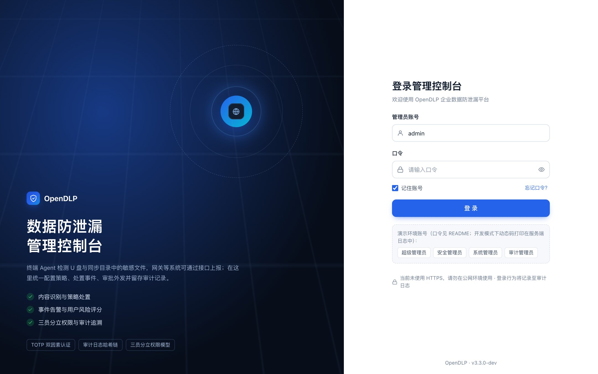 登录（演示模式显示示例账号） | 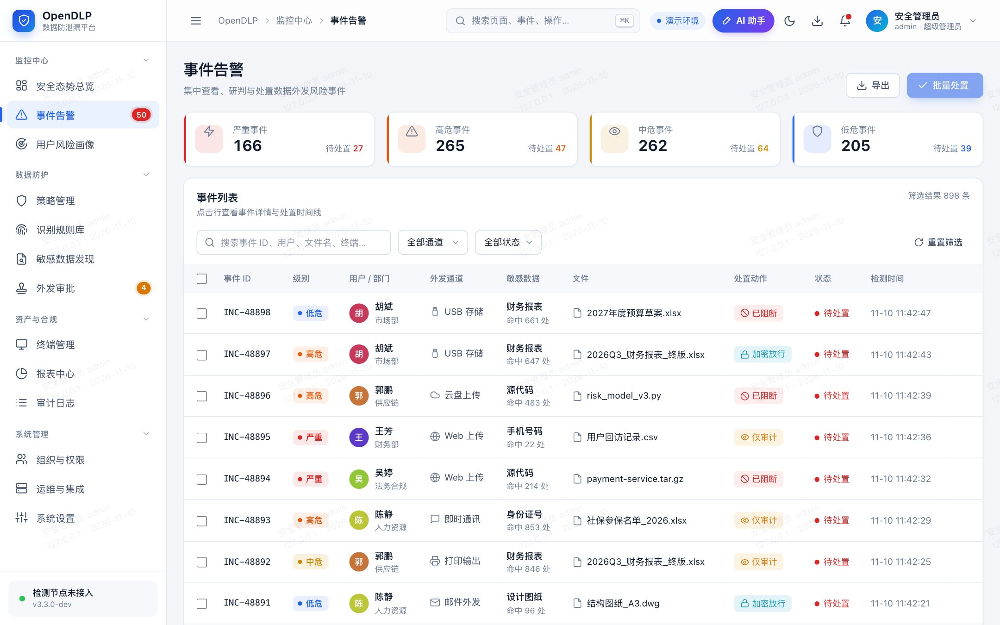 事件告警 |
| 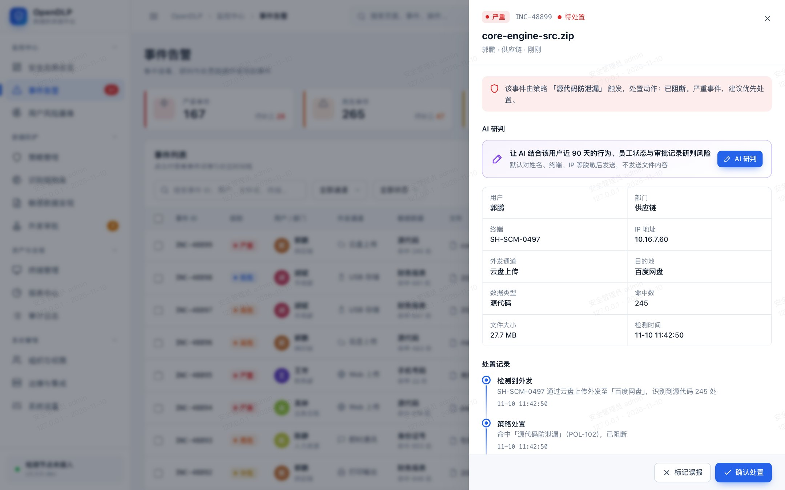 事件详情与 AI 研判入口 | 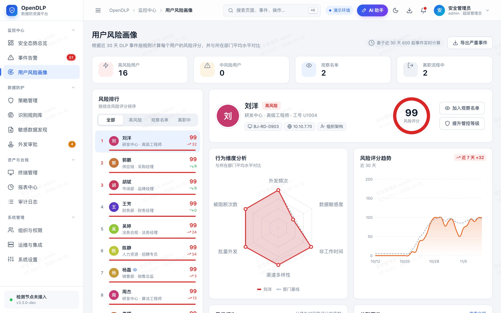 用户风险画像 |
| 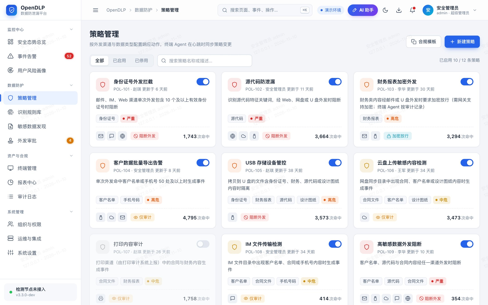 策略管理 | 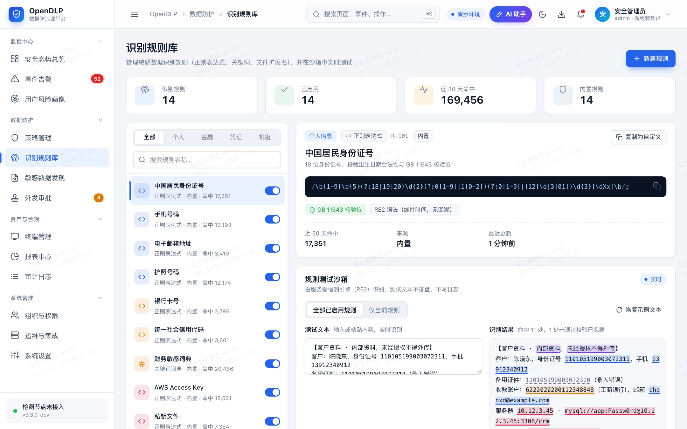 识别规则与测试沙箱 |
| 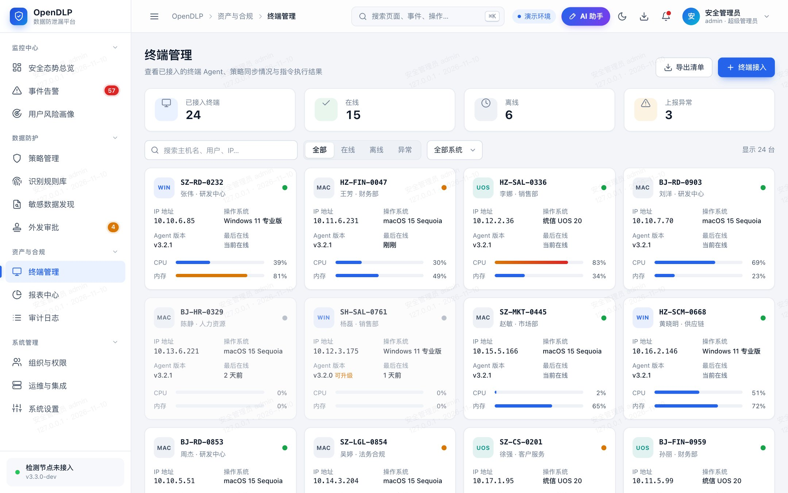 终端管理 | 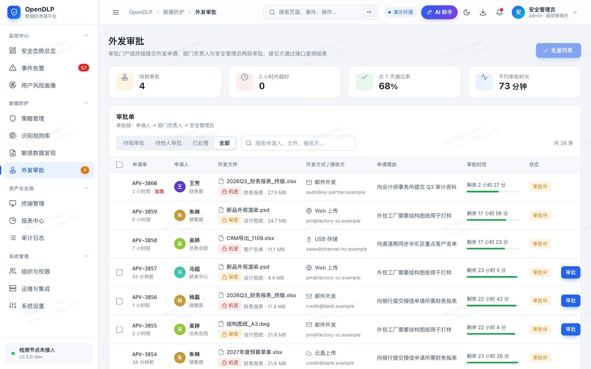 外发审批 |
| 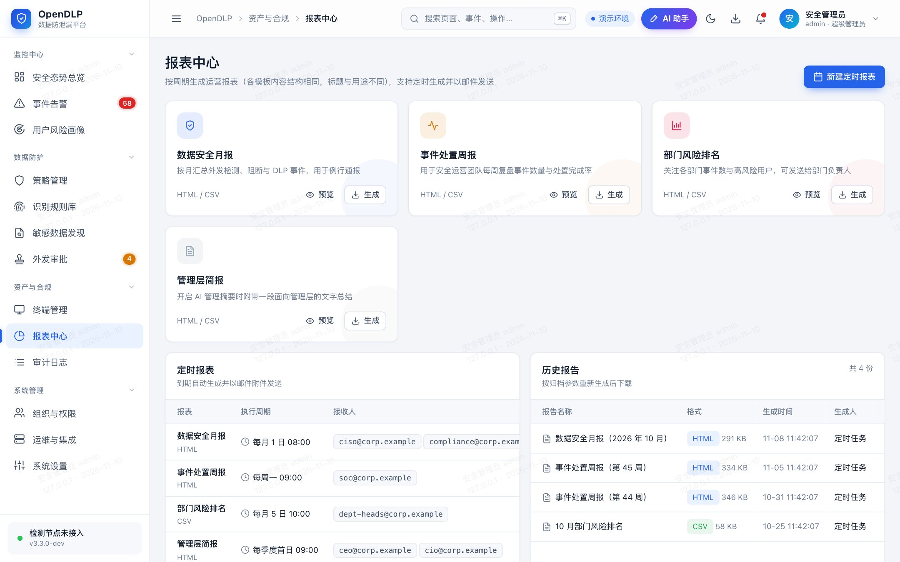 报表中心 | 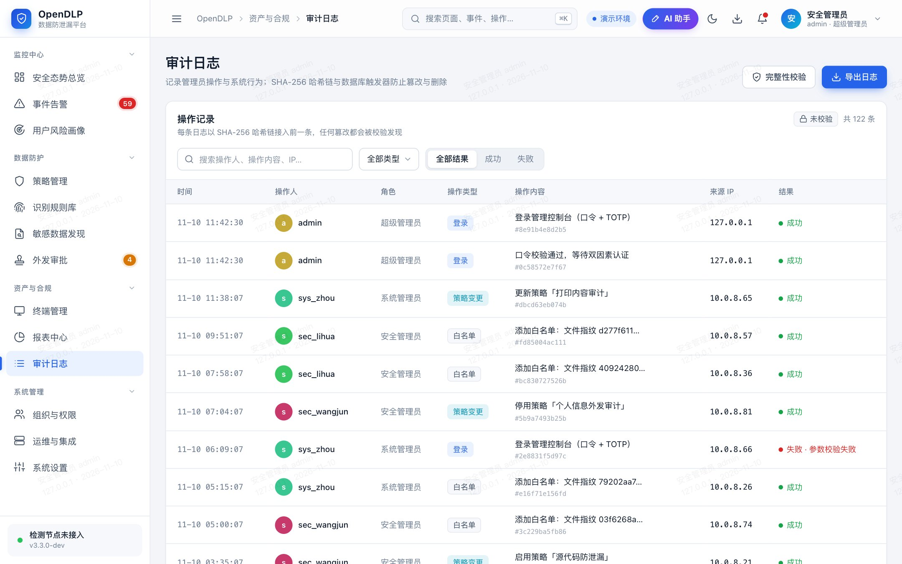 审计日志 |
| 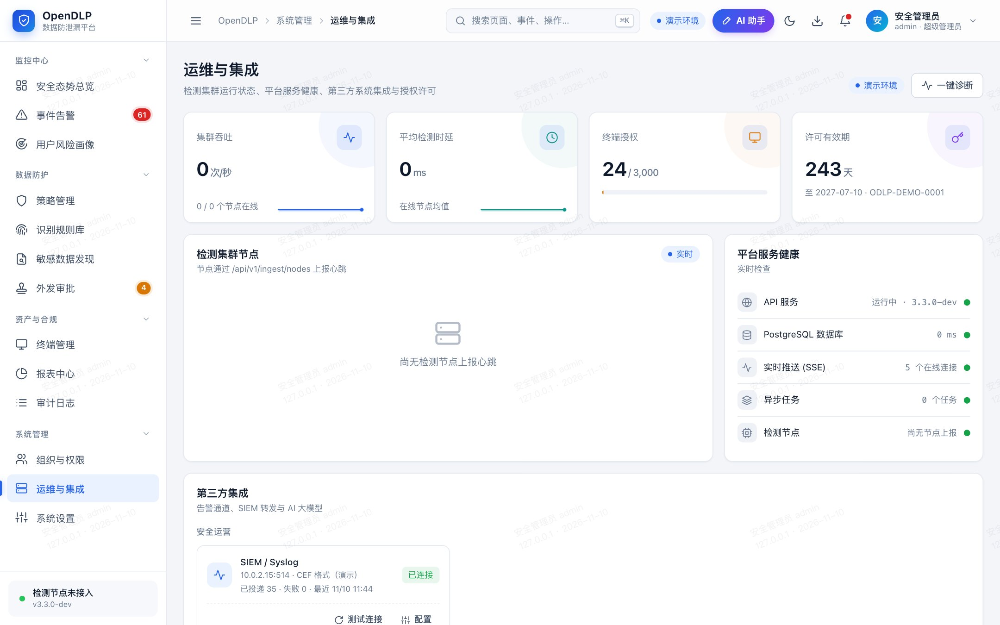 运维与集成（检测节点区域只显示第三方系统上报的心跳，演示数据中没有） | 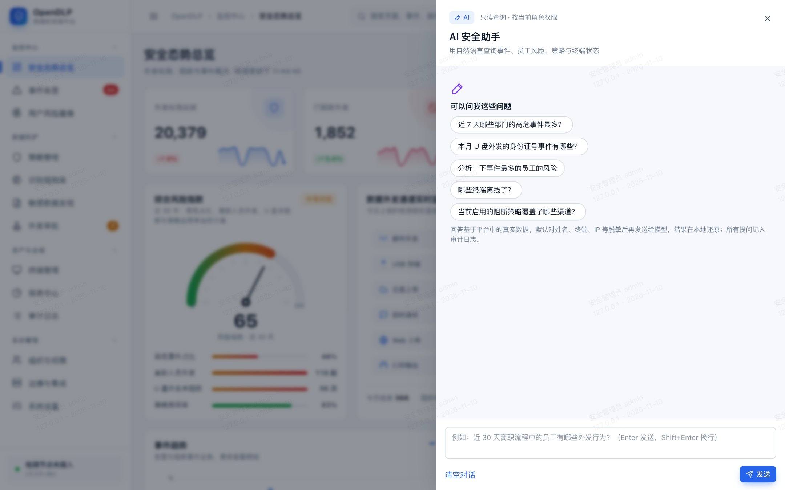 AI 安全助手（未接入模型时的初始界面） |

## 快速开始（本地）

需要 Go 1.24+ 与 PostgreSQL（开发与测试使用 PostgreSQL 18，docker-compose 中为 16；更早的版本未测试）。

```bash
createdb opendlp_demo
```

```bash
cd backend
go run ./cmd/opendlp -dev -demo -database-url postgres://$(whoami)@127.0.0.1:5432/opendlp_demo
```

浏览器打开 <http://127.0.0.1:8080>，演示账号 `admin`，口令 `OpenDLP@2026!`；开发模式（`-dev`）下双因素动态码打印在服务端日志中。

不加 `-demo` 时数据库只写入基础数据（渠道、数据类型、内置角色与识别规则），首次访问需要用启动日志中打印的初始化令牌创建超级管理员并绑定 TOTP。生产部署见 [deploy/README.md](deploy/README.md)。

## 终端 Agent

```bash
cd backend
scripts/build-agent.sh 3.3.0
```

产物位于 `backend/bin/agent/`（Windows / macOS 的 amd64、arm64，Linux 的 amd64、arm64、loong64）。安装方式与配置示例见 `deploy/agent/`，控制台「终端管理 → 终端接入」也会给出带注册令牌的安装步骤。

```bash
opendlp-agent run -server https://dlp.example.com -token <注册令牌> -watch cloud=~/Library/CloudStorage
```

macOS 需要为 Agent 授予「完全磁盘访问权限」，否则无法读取 U 盘与用户目录。

## 目录结构

```
backend/    Go 后端、终端 Agent、检测引擎、测试（说明见 backend/README.md）
frontend/   控制台前端，无构建步骤（说明见 frontend/README.md）
deploy/     docker-compose、Caddy 配置、Agent 服务安装文件
docs/       截图
```

## 测试与验证情况

后端测试连接真实 PostgreSQL，每个测试使用独立 schema：

```bash
cd backend
OPENDLP_TEST_DATABASE_URL=postgres://$(whoami)@127.0.0.1:5432/opendlp_test go test -race ./...
```

覆盖范围包括初始化与登录、权限与审计、上报与指令、Agent 端到端流程（注册、策略同步、U 盘隔离、离线补报、凭据吊销后重新注册）、告警通道、定时报表、口令与登录来源限制、AI 分析（脱敏与工具调用，使用模拟的模型服务）。

尚未验证的部分：

- Docker / docker-compose 部署未在本机运行过（开发环境没有 Docker）；
- 终端 Agent 只在 macOS 上实际运行过，Windows、Linux 版本仅通过交叉编译；
- AI 功能只用模拟的 OpenAI 兼容服务测试过，没有接入过真实的模型服务；
- 没有做过性能与大规模终端接入测试。

更详细的接口、配置与安全设计说明见 [backend/README.md](backend/README.md)。
